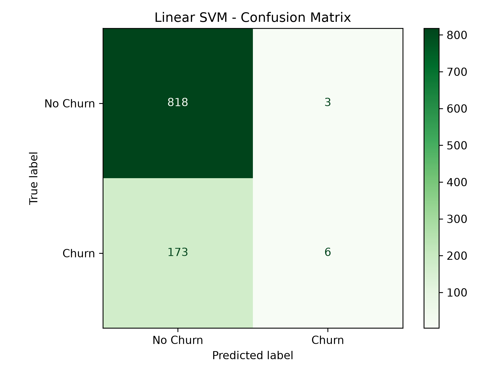
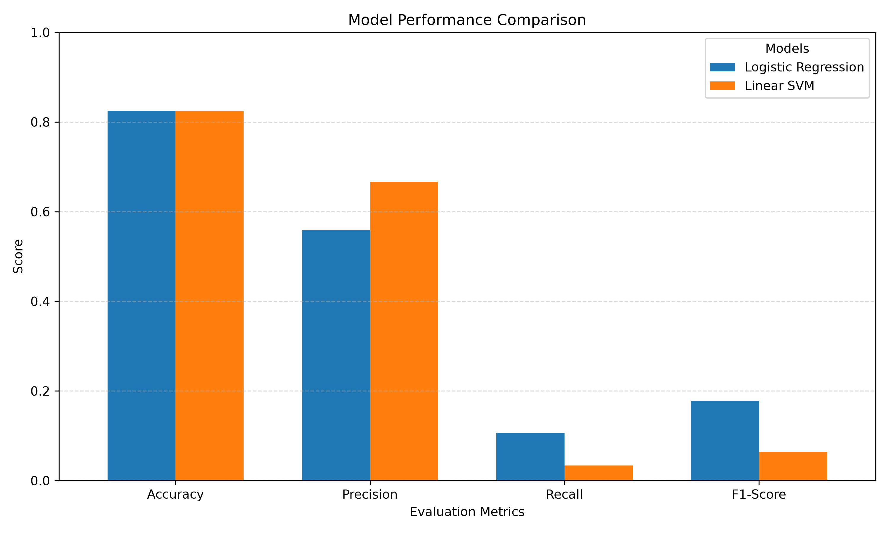
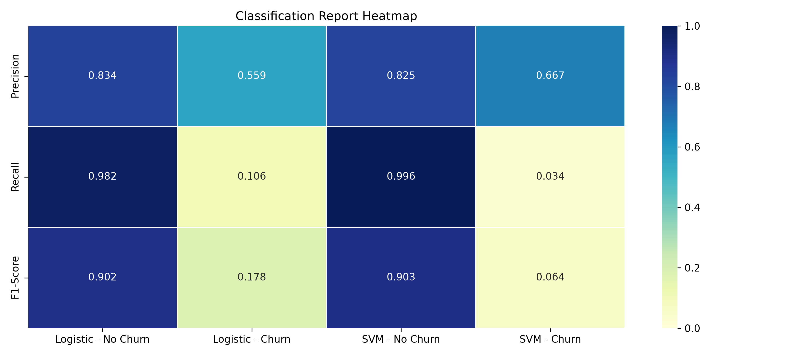

# CityNet Customer Churn Prediction

## 1. Project Overview

CityNet Customer Churn Prediction is a machine learning project that aims to identify customers who are likely to leave a telecom service.

The goal is to help the customer retention team identify high-risk customers and prioritize them for follow-up calls.

## 2. User Story

As a retention manager, I want a weekly list of the 100 customers most likely to cancel their service next month so that my team can contact them first.

## 3. Dataset Overview

The project uses a customer churn dataset containing:

- **Total records:** 5,000 customers
- **Total columns:** 14
- **Target variable:** `churned`
- **Prediction target:** Whether a customer leaves the service.

Target variable values:

- `0` – Customer did not leave.
- `1` – Customer left the service.

## 4. Lab 1 – Dataset Understanding and EDA

In this lab, we explored the dataset to understand its structure, quality, and customer churn patterns.

### Tasks Completed

- Loaded and inspected the dataset.
- Checked dataset dimensions and column names.
- Reviewed data types and missing values.
- Generated statistical summaries.
- Analyzed the target variable.
- Explored categorical and numerical features.
- Performed final data quality checks.

### Data Quality Findings

| Column | Missing Values |
|---|---:|
| `age` | 411 (8.22%) |
| `payment_method` | 149 (2.98%) |
| Other columns | 0 |

Additional checks:

- Total unique customer IDs: 5,000
- Duplicate customer IDs: 0

Missing values will be handled during the preprocessing stage.

### Key Findings

1. The overall customer churn rate is **17.92%**.
2. The Central region has the highest churn rate at **21.21%**.
3. The Fiber 100 plan has the highest churn rate at **21.23%**.
4. Customers using cash payment have the highest churn rate at **27.79%**.
5. Churned customers have a lower average tenure (26.43 months) than non-churned customers (39.43 months).
6. Churned customers also have higher average support calls and outage hours.
7. The `cancel_request_logged` feature has a strong association with churn and needs to be reviewed for potential data leakage.

**Note:** These findings show associations in the dataset. They do not prove that a particular factor directly causes customer churn.

## 5. Lab 2 – Data Preprocessing

In this lab, we prepared the dataset for machine learning.

### Tasks Completed

- Separated features and target variable.
- Removed customer_id and cancel_request_logged.
- Identified numerical and categorical features.
- Split data into training (80%) and testing (20%).
- Handled missing values using median and mode.
- Converted categorical features using One-Hot Encoding.
- Scaled numerical features using StandardScaler.
- Used pipelines to organize preprocessing steps.

### Data Splitting Results

| Dataset | Records |
|---|---:|
| Training | 4,000 (80%) |
| Testing | 1,000 (20%) |

### Preprocessing Results

| Description | Result |
|---|---:|
| Original Features | 11 |
| Processed Features | 22 |
| Training Churners | 717 |
| Testing Churners | 179 |

The preprocessing pipeline was fitted on training data and applied to testing data to avoid data leakage.

## 6. Lab 3 – Model Training and Saving

### Objective
Train machine learning models to predict customer churn and save trained models for future evaluation and predictions.

### Models Used

1. **Logistic Regression**
   - Used as the baseline model.
   - Trained with numerical feature scaling.

2. **Linear Support Vector Machine (SVM)**
   - Used as the main candidate model.
   - Trained with numerical feature scaling.

### Training Setup

- Dataset: 5,000 customer records
- Training data: 80% (4,000 records)
- Testing data: 20% (1,000 records)
- Random state: 42
- Stratified train-test split
- Missing values handled using imputation.
- Categorical features encoded using One-Hot Encoding.
- Numerical features scaled using StandardScaler.
- Scikit-learn Pipelines used for preprocessing and model training.

### Training Results

- Logistic Regression: Successfully trained.
- Linear SVM: Successfully trained.

### Model Saving

Both trained models were saved using the Joblib library.

Saved model files:

```text
models/
├── logistic_model.joblib
└── svm_model.joblib
```

- Complete preprocessing and model pipelines were saved.
- Models can be loaded later without retraining.
- Saved models will be used for future evaluation and predictions.

### Important Note

- Both models use the same training and testing split.
- Each model has its own preprocessing pipeline.
- Model performance evaluation will be performed in Lab 4.
- Final model selection will be based on evaluation and comparison results.

# Lab 4 – Model Evaluation

## CityNet Customer Churn Prediction

### 1. Overview

Lab 4 focuses on evaluating two trained Machine Learning models:

- Logistic Regression
- Linear Support Vector Machine (SVM)

The purpose of this lab is to measure model performance using different classification metrics and visualizations.

Both models are evaluated using the same testing dataset containing 1,000 customer records.

### 2. Objectives

- Load previously trained Machine Learning models.
- Generate predictions on testing data.
- Calculate classification evaluation metrics.
- Generate and analyze confusion matrices.
- Compare model performance.
- Visualize classification reports using heatmaps.
- Evaluate models using ROC and Precision-Recall curves.
- Save evaluation diagrams for future reference.

### 3. Models Evaluated

| Model | Description |
|---|---|
| Logistic Regression | A classification algorithm used to predict customer churn. |
| Linear SVM | A Support Vector Machine classifier used to distinguish churn and non-churn customers. |

### 4. Dataset Information

| Description | Value |
|---|---:|
| Total Records | 5,000 |
| Total Features | 11 |
| Training Records | 4,000 |
| Testing Records | 1,000 |
| Target Variable | Customer Churn |

Both models were evaluated using the same testing dataset.

### 5. Evaluation Metrics

The following metrics were used:

**Accuracy:** Measures the overall percentage of correct predictions.

**Precision:** Measures how many predicted churn customers actually churned.

**Recall:** Measures how many actual churn customers were correctly identified.

**F1-Score:** Provides a balance between precision and recall.

**ROC-AUC:** Measures the model's ability to distinguish between churn and non-churn customers.

**Average Precision (AP):** Summarizes performance across different precision-recall thresholds.

### 6. Model Evaluation Results

The following results were obtained during testing:

| Metric | Logistic Regression | Linear SVM |
|---|---:|---:|
| Accuracy | 82.50% | 82.40% |
| Precision | 55.88% | 66.67% |
| Recall | 10.61% | 3.35% |
| F1-Score | 17.84% | 6.38% |
| ROC-AUC | 72.47% | 72.35% |
| Average Precision | 40.18% | 39.98% |

### 7. Evaluation Visualizations

All six evaluation diagrams were generated and saved in the `results/` directory.

#### 7.1 Logistic Regression – Confusion Matrix


#### 7.2 Linear SVM – Confusion Matrix



#### 7.3 Model Performance Comparison



#### 7.4 Classification Report Heatmap



#### 7.5 ROC Curve Comparison


#### 7.6 Precision-Recall Curve Comparison


### 8. Results Analysis

Based on the evaluation results:

- Logistic Regression achieved 82.50% accuracy.
- Linear SVM achieved 82.40% accuracy.
- Linear SVM achieved higher precision (66.67%).
- Logistic Regression achieved higher recall (10.61%).
- Logistic Regression achieved a higher F1-score (17.84%).
- Both models achieved similar ROC-AUC and Average Precision scores.

**Important Observation:**

Although both models achieved approximately 82% accuracy, their recall scores were very low.

This indicates that both models missed a significant number of actual churn customers.

This may be related to class imbalance in the dataset and requires further investigation.

Therefore, accuracy alone is not sufficient to determine the best churn prediction model.

### 9. Project Structure

```text
citynet-churn/
│
├── data/
│
├── models/
│   ├── logistic_model.joblib
│   └── svm_model.joblib
│
├── src/
│   ├── data_preprocessing.py
│   └── 04_model_evaluation.py
│
├── results/
│   ├── logistic_confusion_matrix.png
│   ├── svm_confusion_matrix.png
│   ├── model_performance_comparison.png
│   ├── classification_report_heatmap.png
│   ├── roc_curve_comparison.png
│   └── precision_recall_curve_comparison.png
│
├── requirements.txt
└── README.md
```
**Lab 5 – Model Experiments and Comparison**

The next lab will focus on:

- Investigating class imbalance.
- Experimenting with model configurations.
- Exploring techniques to improve churn detection.
- Comparing model performance.
- Identifying a suitable model for customer churn prediction.

---

**Project:** CityNet Customer Churn Prediction  
**Lab:** 04 – Model Evaluation  
**Status:** Completed

## Lab 5 – Model Improvement & Comparison

### Objective
The objective of Lab 5 was to improve customer churn prediction by experimenting with different machine learning models and comparing their performance using multiple evaluation metrics.

### Models Experimented

Five model configurations were evaluated:

1. Logistic Regression – Baseline model.
2. Linear SVM with Feature Scaling.
3. Linear SVM without Feature Scaling.
4. Random Forest with class balancing.
5. Tuned Linear SVM using GridSearchCV.

### Hyperparameter Tuning

GridSearchCV was used to find the best Linear SVM parameters.

- Best C: `1`
- Best class_weight: `balanced`
- Cross-validation: `5-fold StratifiedKFold`
- Best Cross-Validation F1-score: `0.4262`

### Model Comparison Results

| Model | Accuracy | Precision | Recall | F1-Score | PR-AUC (AP) |
|---|---:|---:|---:|---:|---:|
| Logistic Regression | 0.8250 | 0.5588 | 0.1061 | 0.1784 | **0.4018** |
| Linear SVM (Scaled) | 0.8240 | 0.6667 | 0.0335 | 0.0638 | 0.3998 |
| Linear SVM (Unscaled) | 0.8250 | 0.7500 | 0.0335 | 0.0642 | 0.3953 |
| Random Forest | 0.7830 | 0.3443 | 0.2346 | 0.2791 | 0.3183 |
| Tuned Linear SVM | 0.6660 | 0.2966 | **0.6313** | **0.4036** | 0.4014 |

### Evaluation Metrics

- **Accuracy:** Overall percentage of correct predictions.
- **Precision:** How many customers predicted as churners actually churned.
- **Recall:** How many actual churners the model successfully identified.
- **F1-Score:** Harmonic balance between Precision and Recall.
- **PR-AUC (AP):** Measures the model's precision-recall performance across different classification thresholds.

### Final Model Selection

The Tuned Linear SVM was selected as the provisional candidate for business evaluation.

Reasons:

- Highest Recall: `0.6313`
- Highest F1-Score: `0.4036`
- PR-AUC (AP): `0.4014`

Logistic Regression achieved the highest PR-AUC (AP) of `0.4018`. However, the difference between the two models was very small (`0.0004`).

Since the business objective is to identify as many potential churn customers as possible, Tuned Linear SVM is the more suitable candidate for the next business evaluation stage.

### Output

Model comparison results are saved in:

`results/model_comparison.csv`

### Key Learning

This lab demonstrated that accuracy alone is not sufficient for evaluating models on an imbalanced dataset. Recall, F1-Score, and PR-AUC provide additional insight into churn prediction performance.

**Next:** Lab 6 – Business Evaluation: Identifying the Top 100 High-Risk Customers and evaluating a customer retention strategy.

# Lab 6 – Business Evaluation & Retention Strategy

## 1. Overview

In this lab, the selected machine learning model was used to identify high-risk customers and convert churn predictions into actionable business retention strategies.

The main objective was to identify customers who are likely to churn, recommend suitable retention actions, and estimate the potential financial benefits of customer retention.

## 2. Selected Machine Learning Model

**Selected Model:** Linear Support Vector Machine (Linear SVM)

Configuration:
- C = 1
- class_weight = balanced

The selected model was used to generate churn risk scores and rank customers according to their predicted risk.

## 3. Business Evaluation

The model was evaluated on 1,000 test customers.

The top 100 customers with the highest churn risk scores were selected for business evaluation.

| Metric | Result |
|---|---:|
| Test Customers | 1,000 |
| High-Risk Customers Selected | 100 |
| Actual Churners in Top 100 | 51 |
| Non-Churners in Top 100 | 49 |
| Precision@100 | 51% |

**Business Interpretation:**

Out of the top 100 highest-risk customers, 51 were actual churners.

Precision@100 of 51% means that 51 out of every 100 customers selected by the model were actual churners in the test dataset.

## 4. Retention Strategy Design

The retention strategy was designed for the 49 active customers identified among the top 100 high-risk customers.

Four retention actions were recommended:

| Retention Action | Customers |
|---|---:|
| Service Recovery | 17 |
| Special Discount Offer | 14 |
| Priority Customer Support | 12 |
| Loyalty Offer | 6 |
| **Total** | **49** |

Already churned customers were excluded from retention action assignment.

## 5. Business Impact Analysis

The potential financial impact was estimated using the following business assumptions.

### Business Assumptions

| Parameter | Value |
|---|---:|
| Discount Rate | 10% |
| Discount Duration | 3 Months |
| Expected Retention Rate | 30% |
| Retained Revenue Period | 6 Months |
| Gross Margin | 60% |

### Financial Results

| Metric | Estimated Value |
|---|---:|
| Potential Retention Targets | 49 |
| Average Monthly Bill | 4,765.92 |
| Expected Retained Customers | 14.70 |
| Expected Saved Revenue | 420,354.00 |
| Expected Gross Contribution | 252,212.40 |
| Estimated Discount Cost | 21,017.70 |
| **Estimated Net Business Benefit** | **231,194.70** |

**Business Interpretation:**

Based on the assumed 30% retention rate, approximately 14.7 customers could potentially be retained.

After accounting for estimated discount costs, the projected net business benefit is 231,194.70.

These figures represent estimated business impact based on assumptions, not actual realized revenue or profit.

## 6. Generated Output

The business evaluation generated the following CSV report:

`results/top_100_high_risk_customers.csv`

The report contains 100 high-risk customers and 10 columns:

- risk_rank
- customer_id
- actual_churn
- risk_score
- monthly_bill
- support_calls_90d
- outage_hours_90d
- tenure_months
- paid_late_last_bill
- retention_action

### CSV Verification

- Total records: 100
- Total columns: 10
- Customers with retention actions: 49
- Customers without retention actions: 51
- Missing retention actions among active customers: 0

## 7. Key Learning Outcomes

Through this lab, the following concepts were implemented:

- Business-oriented model evaluation.
- Customer churn risk ranking.
- Top-N customer identification.
- Precision@100 calculation.
- Retention strategy recommendation.
- Financial impact estimation.
- Translating machine learning predictions into business decisions.

## 8. Conclusion

Lab 6 successfully connected machine learning predictions with practical business decisions.

The selected Linear SVM model identified the top 100 high-risk customers. A retention strategy was designed for 49 active high-risk customers, and the estimated net business benefit was calculated as 231,194.70.

This demonstrates how customer churn prediction can support proactive customer retention and data-driven business planning.

# Lab 7 – New Customer Churn Prediction

## 1. Overview

In this lab, we use the saved Linear Support Vector Machine (Linear SVM) model from Lab 6 to predict customer churn for 8 new customers.

The model is loaded from the saved file. It is **not retrained** in this lab.

The objective is to generate churn predictions, calculate customer risk scores, and save the results into a CSV report.

## 2. Objectives

- Load the previously saved Linear SVM pipeline.
- Load new customer data from a CSV file.
- Verify that all required features are available.
- Generate churn predictions using the saved model.
- Calculate decision scores for customer risk ranking.
- Save predictions and risk scores into a CSV report.
- Verify the generated output.

## 3. Project Files

```text
citynet-churn/
│
├── data/
│   ├── citynet_churn.csv
│   └── new_customers.csv
│
├── models/
│   └── selected_linear_svm.joblib
│
├── results/
│   └── new_customer_predictions.csv
│
├── src/
│   ├── data_preprocessing.py
│   ├── 06_business_evaluation.py
│   └── 07_new_customer_predictions.py
│
└── README.md
```

## 4. Input Dataset

**File:** `data/new_customers.csv`

The dataset contains 8 new customers and 11 input features.

The `customer_id` column is used to identify customers and is not used as a model feature.

The model uses the same preprocessing pipeline and feature structure that were used during training.

## 5. Saved Model

**Model file:** `models/selected_linear_svm.joblib`

The saved file contains the complete Scikit-learn Pipeline:

- Preprocessing
- Numerical feature imputation and scaling
- Categorical feature imputation and encoding
- Linear SVM classifier

The complete pipeline is loaded using Joblib.

No model retraining is performed in Lab 7.

## 6. Prediction Process

The following steps are performed:

1. Verify the input dataset and saved model.
2. Load the new customer dataset.
3. Separate customer IDs from model features.
4. Verify all 11 required features.
5. Load the saved Linear SVM pipeline.
6. Generate churn predictions using `predict()`.
7. Generate decision scores using `decision_function()`.
8. Sort customers by risk score.
9. Save the results into a CSV file.
10. Reload and verify the generated CSV report.

## 7. Prediction Results

The saved model generated predictions for all 8 customers.

| Customer ID | Churn Prediction | Risk Score |
|---|---:|---:|
| C90001 | 1 | 0.611320 |
| C90002 | 1 | 0.038960 |
| C90007 | 0 | -0.031730 |
| C90006 | 0 | -0.043645 |
| C90004 | 0 | -0.084072 |
| C90005 | 0 | -0.284152 |
| C90003 | 0 | -0.375793 |
| C90008 | 0 | -0.618889 |

### Prediction Labels

- `1` = Customer predicted to churn.
- `0` = Customer predicted not to churn.

### Risk Score Explanation

The Linear SVM `decision_function()` returns decision scores, not probability percentages.

- A positive score indicates a prediction towards the churn class.
- A negative score indicates a prediction towards the non-churn class.
- Higher scores indicate a stronger model decision towards churn.

C90001 has the highest churn decision score, followed by C90002.

## 8. Business Findings

Out of 8 new customers:

- Predicted churners: 2
- Predicted non-churners: 6
- Predicted churn rate: 25%
- Predicted non-churn rate: 75%

### Business Recommendation

The business can prioritize C90001 and C90002 for customer retention activities.

Possible actions include:

- Contacting high-risk customers.
- Understanding their service-related complaints.
- Reviewing their billing and payment experience.
- Offering suitable retention plans where appropriate.
- Monitoring customer satisfaction.

These are model-based predictions and should be reviewed alongside actual customer feedback before taking business action.

## 9. Output Report

**Generated file:**

`results/new_customer_predictions.csv`

The report contains three columns:

| Column | Description |
|---|---|
| customer_id | Unique customer identifier |
| churn_prediction | Predicted churn class (0 or 1) |
| risk_score | Linear SVM decision score |

## 10. How to Run Lab 7

Open PowerShell in the project directory:

```powershell
cd D:\citynet-churn
```

Activate the virtual environment:

```powershell
.\.venv\Scripts\Activate.ps1
```

Run the prediction script:

```powershell
python src/07_new_customer_predictions.py
```

The generated report will be saved in the `results` directory.

## 11. Final Verification

The following checks were successfully completed:

| Verification | Result |
|---|---:|
| Total customers predicted | 8 |
| Missing predictions | 0 |
| Missing risk scores | 0 |
| Predicted churners | 2 |
| Predicted non-churners | 6 |
| CSV file generated | True |

## 12. Conclusion

Lab 7 successfully demonstrated how to use a previously trained and saved Linear SVM pipeline to predict churn for new customers.

The model generated predictions and decision scores for all 8 customers, and the results were successfully saved and verified in a CSV report.

**Lab 7 Status: Completed**

**Project:** CityNet Customer Churn Prediction  
**Technology:** Python, Pandas, Scikit-learn, Joblib  
**Model:** Linear Support Vector Machine (Linear SVM)


### 10. How to Run

**Step 1: Activate the virtual environment**

```powershell
.\.venv\Scripts\Activate.ps1
```

**Step 2: Install dependencies**

```powershell
pip install -r requirements.txt
```

**Step 3: Run Lab 4**

```powershell
python src/04_model_evaluation.py
```

The evaluation results will be displayed in the terminal, and all six diagrams will be saved automatically in the `results/` directory.

**Note:** Lab 4 requires the trained model files from Lab 3 and the preprocessing module from Lab 2.

### 11. Conclusion

In this lab, Logistic Regression and Linear SVM were evaluated using multiple classification metrics and visualizations.

Both models demonstrated similar overall accuracy and ROC-AUC performance. However, their low recall scores indicate that churn detection needs further improvement.

The evaluation results provide a foundation for the next stage of the project.

### 12. Next Steps


## 7. How to Run

Install the required dependencies:

```bash
pip install -r requirements.txt
```

Train and save the machine learning pipeline:

```bash
python src/lab7_save.py
```

Generate predictions for new customers:

```bash
python src/predict.py data/new_customers.csv
```

The prediction script writes results to:

`reports/predictions.csv`

## 8. Model Results

Model performance will be documented after training and evaluation.

| Metric | Baseline | Our Model |
|---|---|---|
| PR-AUC | Pending | Pending |
| Churners in Top 100 | Pending | Pending |

## 9. Intended Use

The model is intended to help the customer retention team prioritize customers who may be at risk of leaving the service.

Predictions should support human decision-making and customer outreach.

## 10. Not for

- Automatically cancelling customer accounts.
- Making final business decisions without human review.
- Treating predictions as guaranteed outcomes.

## 11. Assumptions

- Historical customer information can help identify churn patterns.
- Customer features are available before the prediction date.
- The target variable represents customer churn.
- Predictions are used to prioritize retention efforts.

## 12. Risks and Limitations

- Missing values may affect model performance.
- Historical patterns may change over time.
- The dataset may not represent all real-world customer behaviour.
- Some features may introduce data leakage if they contain information recorded after a customer decides to leave.
- Model predictions are estimates, not guarantees.
