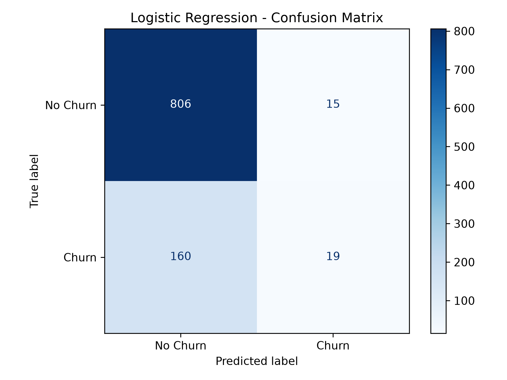
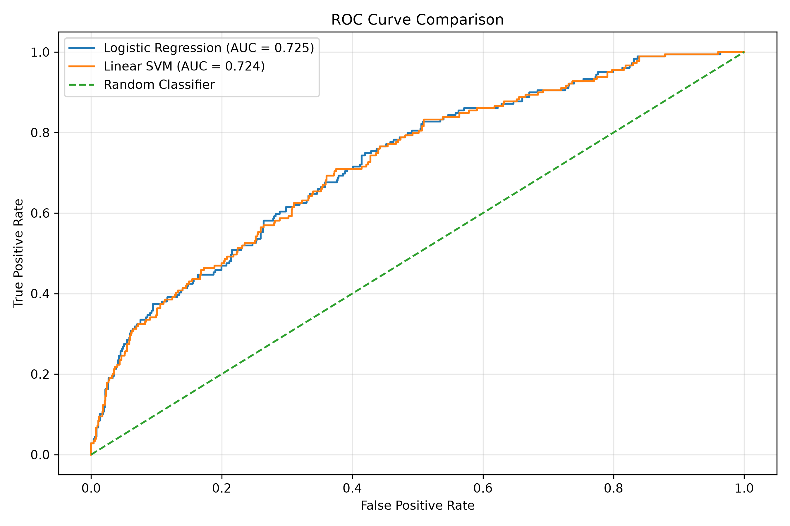
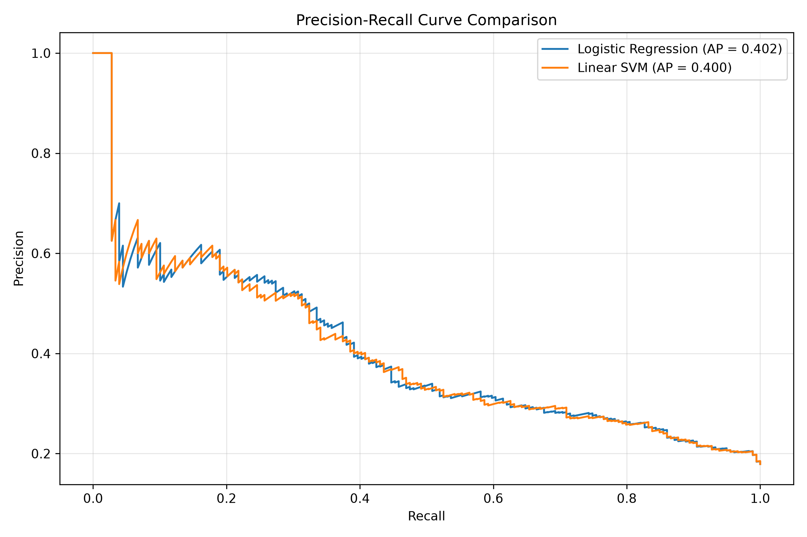

# CityNet Customer Churn Prediction & Retention Call List

A machine learning project using Linear Support Vector Machine (SVM) to identify customers at risk of leaving a telecommunications service and prioritize retention calls.

## 1. Project Overview

CityNet Customer Churn Prediction is a machine learning project designed to identify telecommunications customers who are likely to cancel their subscriptions.

The project uses historical customer data to train and evaluate machine learning models, rank customers according to their churn risk, and generate a prioritized retention call list.

The main candidate model is a tuned Linear Support Vector Machine (SVM). Its predictions help the retention team identify high-risk customers and prioritize customer outreach.

## 2. Problem Statement

CityNet, a telecommunications service provider, wants to identify customers who are likely to cancel their subscriptions in the coming month.

The retention team can contact only 100 customers per week. The company's existing Logistic Regression model identifies approximately 49 customers likely to leave among every 100 selected calls.

The objective is to develop and evaluate a Linear SVM model that ranks customers according to their churn risk.

The project compares the SVM model with the Logistic Regression baseline, identifies the 100 highest-risk customers, investigates factors associated with churn, and evaluates potential customer retention strategies.

The model supports informed customer outreach. It does not automatically cancel, penalize, or modify customer subscriptions.

## 3. Project Objectives

- Understand customer data and identify churn patterns.
- Perform data cleaning and preprocessing.
- Train Logistic Regression and Linear SVM models.
- Evaluate models using appropriate classification metrics.
- Improve churn detection through model experimentation and hyperparameter tuning.
- Identify the top 100 highest-risk customers.
- Evaluate potential customer retention strategies and financial impact.
- Save the selected model pipeline for future predictions.
- Generate churn predictions for new customers.

## 4. User Story

As a customer retention manager, I want a weekly list of the 100 customers most likely to cancel their subscriptions so that my team can prioritize retention calls and take appropriate action.

## 5. Project Roadmap

The project was completed through eight stages, from environment setup to generating predictions for new customers.

| Lab | Description | Status |
|---|---|---|
| Lab 0 | GitHub & Environment Setup | Completed |
| Lab 1 | Dataset Understanding & Exploratory Data Analysis | Completed |
| Lab 2 | Data Preprocessing | Completed |
| Lab 3 | SVM Model Training | Completed |
| Lab 4 | Model Evaluation | Completed |
| Lab 5 | Model Improvement & Comparison | Completed |
| Lab 6 | Business Evaluation & Retention Strategy | Completed |
| Lab 7 | Model Saving & New Customer Prediction | Completed |

## 6. Dataset Overview

The project uses a telecommunications customer churn dataset containing historical customer information and service-related features.

| Description | Value |
|---|---:|
| Total Records | 5,000 |
| Total Columns | 14 |
| Unique Customers | 5,000 |
| Duplicate Customer IDs | 0 |
| Target Variable | `churned` |
| Missing Values | Present in 2 columns |

### Target Variable

The target variable is `churned`, which indicates whether a customer left the service.

| Value | Meaning |
|---|---|
| 0 | Customer did not leave |
| 1 | Customer left |

### Data Quality Findings

Two columns contained missing values:

| Column | Missing Values | Percentage |
|---|---:|---:|
| `age` | 411 | 8.22% |
| `payment_method` | 149 | 2.98% |
| Other columns | 0 | 0% |

Missing values were handled during preprocessing using median and mode imputation.

### Important Feature Considerations

- `customer_id` was removed because it is an identifier rather than a predictive feature.
- `cancel_request_logged` was excluded because it has a strong association with churn and could introduce data leakage.

After removing these two columns, 11 input features remained for model training.

## 7. Technologies Used

The project was developed using the following technologies and libraries.

| Technology | Purpose |
|---|---|
| Python | Programming language |
| Pandas | Data manipulation and analysis |
| NumPy | Numerical operations |
| Scikit-learn | Data preprocessing and machine learning |
| Matplotlib | Data visualization |
| Seaborn | Statistical visualization |
| Joblib | Saving and loading trained models |
| Git | Version control |
| GitHub | Source code management |

## 8. Project Structure

The project is organized into separate directories for datasets, source code, trained models, and generated results.

```text
citynet-churn/
│
├── data/
│   ├── citynet_churn.csv
│   └── new_customers.csv
│
├── models/
│   ├── logistic_model.joblib
│   ├── svm_model.joblib
│   └── selected_linear_svm.joblib
│
├── results/
│   ├── logistic_confusion_matrix.png
│   ├── svm_confusion_matrix.png
│   ├── model_performance_comparison.png
│   ├── classification_report_heatmap.png
│   ├── roc_curve_comparison.png
│   ├── precision_recall_curve_comparison.png
│   ├── model_comparison.csv
│   ├── top_100_high_risk_customers.csv
│   └── new_customer_predictions.csv
│
├── src/
|   ├── 01_data_inspection.py
│   ├── data_preprocessing.py
|   ├── 03_model_training.py
│   ├── 04_model_evaluation.py
│   ├── 05_model_experiments.py
│   ├── 06_business_evaluation.py
│   └── 07_new_customer_predictions.py
│
├── .venv/
├── .gitignore
├── DATA.md
├── requirements.txt
└── README.md
```
**Note:** The structure highlights the main documented files and outputs, including `DATA.md`. Additional scripts or configuration files may exist in the repository.

## 9. Project Methodology

The project follows a structured machine learning workflow consisting of data exploration, preprocessing, model training, evaluation, improvement, business analysis, and prediction.

### Lab 1 – Dataset Understanding & Exploratory Data Analysis

**Objective:** Understand the dataset, examine data quality, and identify customer churn patterns.

**Tasks Completed:**

- Loaded and inspected the dataset.
- Examined dataset dimensions and column names.
- Reviewed data types and missing values.
- Generated statistical summaries.
- Analyzed the target variable distribution.
- Explored categorical and numerical features.
- Performed final data quality checks.

**Key Findings:**

1. Overall customer churn rate: 17.92%.
2. Central region had the highest churn rate: 21.21%.
3. Fiber 100 plan had the highest churn rate: 21.23%.
4. Customers using cash payment had the highest churn rate: 27.79%.
5. Churned customers had a lower average tenure (26.43 months) than non-churned customers (39.43 months).
6. Churned customers also had higher average support calls and outage hours.
7. `cancel_request_logged` showed a strong association with churn and required leakage investigation.

These findings represent associations in the dataset and do not establish direct causes of customer churn.

### Lab 2 – Data Preprocessing

**Objective:** Prepare customer data for machine learning.

**Tasks Completed:**

- Separated input features and target variable.
- Removed `customer_id` and `cancel_request_logged`.
- Identified numerical and categorical features.
- Split the dataset into training and testing sets.
- Handled missing values using median and mode imputation.
- Encoded categorical variables using One-Hot Encoding.
- Scaled numerical features using StandardScaler.
- Organized preprocessing steps using Scikit-learn pipelines.

**Data Splitting:**

| Dataset | Records | Percentage |
|---|---:|---:|
| Training | 4,000 | 80% |
| Testing | 1,000 | 20% |
| Total | 5,000 | 100% |

**Preprocessing Results:**

| Description | Result |
|---|---:|
| Original Dataset Columns | 14 |
| Removed Columns | 2 |
| Original Input Features | 11 |
| Processed Features | 22 |
| Training Churners | 717 |
| Testing Churners | 179 |

The preprocessing pipeline was fitted on training data and applied to testing data to prevent data leakage.

### Lab 3 – Model Training

**Objective:** Train machine learning models to predict customer churn.

**Models Trained:**

1. **Logistic Regression**
   - Used as the baseline model.
   - Trained with numerical feature scaling.

2. **Linear Support Vector Machine (SVM)**
   - Used as the main candidate model.
   - Trained with numerical feature scaling.

**Training Configuration:**

- Dataset: 5,000 customer records.
- Training data: 80%.
- Testing data: 20%.
- Random state: 42.
- Stratified train-test split.
- Missing-value imputation.
- One-Hot Encoding.
- StandardScaler.
- Scikit-learn Pipelines.

**Model Saving:**

Both initial trained models were saved using Joblib.

```text
models/
├── logistic_model.joblib
└── svm_model.joblib
```

The saved files contain their respective preprocessing and classification pipelines.

Model performance was evaluated in Lab 4.

### Lab 4 – Model Evaluation

**Objective:** Evaluate Logistic Regression and Linear SVM using multiple classification metrics.

Both models were evaluated using the same testing dataset containing 1,000 customers.

**Evaluation Metrics:**

| Metric | Description |
|---|---|
| Accuracy | Overall percentage of correct predictions. |
| Precision | Percentage of predicted churners who actually churned. |
| Recall | Percentage of actual churners correctly identified. |
| F1-Score | Harmonic balance between precision and recall. |
| ROC-AUC | Measures the model's ability to distinguish between the two classes. |
| Average Precision (AP) | Summarizes precision-recall performance across classification thresholds. |

**Model Evaluation Results:**

| Metric | Logistic Regression | Linear SVM |
|---|---:|---:|
| Accuracy | 82.50% | 82.40% |
| Precision | 55.88% | 66.67% |
| Recall | 10.61% | 3.35% |
| F1-Score | 17.84% | 6.38% |
| ROC-AUC | 72.47% | 72.35% |
| Average Precision | 40.18% | 39.98% |

**Evaluation Analysis:**

- Both models achieved approximately 82% accuracy.
- Linear SVM achieved higher precision.
- Logistic Regression achieved higher recall and F1-score.
- Both models demonstrated similar ROC-AUC and Average Precision scores.
- Both models had very low recall, indicating that many actual churners were missed.

Accuracy alone was not sufficient to determine the best model, especially because the dataset had an imbalanced target distribution.

**Evaluation Visualizations:**

The following diagrams were generated and saved in the `results/` directory.

**Logistic Regression Confusion Matrix**



**Linear SVM Confusion Matrix**


**Model Performance Comparison**


**Classification Report Heatmap**


**ROC Curve Comparison**



**Precision-Recall Curve Comparison**



### Lab 5 – Model Improvement & Comparison

**Objective:** Improve customer churn detection through model experimentation, class balancing, and hyperparameter tuning.

Five model configurations were evaluated:

1. Logistic Regression – Baseline model.
2. Linear SVM with Feature Scaling.
3. Linear SVM without Feature Scaling.
4. Random Forest with Class Balancing.
5. Tuned Linear SVM using GridSearchCV.

**Hyperparameter Tuning:**

GridSearchCV was used to identify suitable Linear SVM hyperparameters.

| Parameter | Selected Value |
|---|---|
| C | 1 |
| class_weight | balanced |
| Cross-validation | 5-fold StratifiedKFold |
| Best Cross-validation F1-score | 0.4262 |

**Model Comparison Results:**

| Model | Accuracy | Precision | Recall | F1-Score | PR-AUC (AP) |
|---|---:|---:|---:|---:|---:|
| Logistic Regression | 0.8250 | 0.5588 | 0.1061 | 0.1784 | 0.4018 |
| Linear SVM (Scaled) | 0.8240 | 0.6667 | 0.0335 | 0.0638 | 0.3998 |
| Linear SVM (Unscaled) | 0.8250 | 0.7500 | 0.0335 | 0.0642 | 0.3953 |
| Random Forest | 0.7830 | 0.3443 | 0.2346 | 0.2791 | 0.3183 |
| Tuned Linear SVM | 0.6660 | 0.2966 | 0.6313 | 0.4036 | 0.4014 |

**Final Model Selection:**

The Tuned Linear SVM was selected as the provisional candidate for business evaluation.

Reasons:

- Highest Recall: 0.6313.
- Highest F1-Score: 0.4036.
- PR-AUC (AP): 0.4014.

Logistic Regression achieved the highest PR-AUC (AP) of 0.4018. However, the difference between the two models was only 0.0004.

Since the primary business objective is to identify as many potential churn customers as possible, Tuned Linear SVM was selected for the next business evaluation stage.

**Output:**

```text
results/model_comparison.csv
```

### Lab 6 – Business Evaluation & Retention Strategy

**Objective:** Convert churn predictions into actionable customer retention strategies and estimate their potential financial impact.

**Selected Model:**

Linear Support Vector Machine (Tuned)

| Parameter | Value |
|---|---|
| C | 1 |
| class_weight | balanced |

The selected model generated churn risk scores and ranked 1,000 test customers.

**Top 100 High-Risk Customers:**

The 100 customers with the highest churn risk scores were selected for business evaluation.

| Metric | Result |
|---|---:|
| Test Customers | 1,000 |
| High-Risk Customers Selected | 100 |
| Actual Churners in Top 100 | 51 |
| Non-Churners in Top 100 | 49 |
| Precision@100 | 51% |

**Business Interpretation:**

Out of the 100 highest-risk customers, 51 were actual churners in the test dataset.

Precision@100 of 51% means that 51 out of every 100 selected customers were actual churners.

**Retention Strategy:**

Retention actions were designed for the 49 active customers identified among the top 100 high-risk customers.

| Retention Action | Customers |
|---|---:|
| Service Recovery | 17 |
| Special Discount Offer | 14 |
| Priority Customer Support | 12 |
| Loyalty Offer | 6 |
| **Total** | **49** |

Customers who had already churned were excluded from retention action assignment.

**Business Impact Analysis:**

The potential financial impact was estimated using the following assumptions.

**Business Assumptions:**

| Parameter | Value |
|---|---:|
| Discount Rate | 10% |
| Discount Duration | 3 Months |
| Expected Retention Rate | 30% |
| Retained Revenue Period | 6 Months |
| Gross Margin | 60% |

**Estimated Financial Results:**

| Metric | Estimated Value |
|---|---:|
| Potential Retention Targets | 49 |
| Average Monthly Bill | 4,765.92 |
| Expected Retained Customers | 14.70 |
| Expected Saved Revenue | 420,354.00 |
| Expected Gross Contribution | 252,212.40 |
| Estimated Discount Cost | 21,017.70 |
| **Estimated Net Business Benefit** | **231,194.70** |

**Business Interpretation:**

Based on the assumed 30% retention rate, approximately 14.7 customers could potentially be retained.

After accounting for estimated discount costs, the projected net business benefit is 231,194.70.

These figures are estimates based on business assumptions, not actual realized revenue or profit.

**Generated Report:**

```text
results/top_100_high_risk_customers.csv
```

The report contains 100 customers and 10 columns:

- `risk_rank`
- `customer_id`
- `actual_churn`
- `risk_score`
- `monthly_bill`
- `support_calls_90d`
- `outage_hours_90d`
- `tenure_months`
- `paid_late_last_bill`
- `retention_action`

**CSV Verification:**

- Total records: 100.
- Total columns: 10.
- Customers with retention actions: 49.
- Customers without retention actions: 51.
- Missing retention actions among active customers: 0.

### Lab 7 – Model Saving & New Customer Prediction

**Objective:** Use the saved Linear SVM pipeline to predict churn for new customers without retraining the model.

**Saved Model:**

```text
models/selected_linear_svm.joblib
```

The saved Scikit-learn Pipeline contains:

- Numerical feature imputation.
- Numerical feature scaling.
- Categorical feature imputation.
- One-Hot Encoding.
- Linear SVM classifier.

The complete pipeline ensures that new customer data receives the same preprocessing used during model training.

**Input Dataset:**

```text
data/new_customers.csv
```

The dataset contains 8 new customers and 11 input features.

The `customer_id` column is retained for customer identification and is not used as a model feature.

**Prediction Process:**

1. Verify the input dataset and saved model.
2. Load the new customer dataset.
3. Separate customer IDs from model features.
4. Verify all 11 required input features.
5. Load the saved Linear SVM pipeline.
6. Generate predictions using `predict()`.
7. Generate decision scores using `decision_function()`.
8. Rank customers by churn risk score.
9. Save predictions into a CSV report.
10. Reload and verify the generated report.

**New Customer Prediction Results:**

| Customer ID | Churn Prediction | Risk Score |
|---|---:|---:|
| C90001 | 1 | 0.611320 |
| C90002 | 1 | 0.038960 |
| C90007 | 0 | -0.031730 |
| C90006 | 0 | -0.043645 |
| C90004 | 0 | -0.084072 |
| C90005 | 0 | -0.284152 |
| C90003 | 0 | -0.375793 |
| C90008 | 0 | -0.618889 |

**Prediction Labels:**

- `1` – Customer predicted to churn.
- `0` – Customer predicted not to churn.

**Risk Score Explanation:**

The Linear SVM `decision_function()` returns decision scores, not probability percentages.

- A positive score indicates a prediction towards the churn class.
- A negative score indicates a prediction towards the non-churn class.
- Higher scores indicate a stronger model decision towards churn.

C90001 has the highest churn decision score, followed by C90002.

**Business Findings:**

| Prediction | Customers |
|---|---:|
| Predicted Churners | 2 |
| Predicted Non-Churners | 6 |
| Total Customers | 8 |

The predicted churn rate was 25%.

**Business Recommendation:**

The retention team can prioritize C90001 and C90002 for customer outreach.

Recommended actions include:

- Contacting high-risk customers.
- Understanding service-related complaints.
- Reviewing billing and payment experiences.
- Offering suitable retention plans where appropriate.
- Monitoring customer satisfaction.

Predictions should be reviewed alongside actual customer feedback before taking business action.

**Generated Prediction Report:**

```text
results/new_customer_predictions.csv
```

The CSV report contains three columns:

| Column | Description |
|---|---|
| customer_id | Unique customer identifier |
| churn_prediction | Predicted churn class (0 or 1) |
| risk_score | Linear SVM decision score |

**Final Verification:**

| Verification | Result |
|---|---:|
| Total Customers Predicted | 8 |
| Missing Predictions | 0 |
| Missing Risk Scores | 0 |
| Predicted Churners | 2 |
| Predicted Non-Churners | 6 |
| CSV File Generated | Yes |

## 10. Final Model Performance

The final candidate model was selected based on its ability to identify potential churn customers rather than relying on accuracy alone.

**Selected Model:** Tuned Linear Support Vector Machine (SVM)

| Evaluation Metric | Result |
|---|---:|
| Accuracy | 66.60% |
| Precision | 29.66% |
| Recall | 63.13% |
| F1-Score | 40.36% |
| PR-AUC (Average Precision) | 40.14% |

**Why Linear SVM?**

The tuned Linear SVM achieved the highest recall and F1-score among the five evaluated configurations.

Its recall of 63.13% indicates that it identified approximately 63 out of every 100 actual churners in the test dataset at its selected classification threshold.

Although Logistic Regression achieved a slightly higher PR-AUC, the tuned SVM provided a better balance between precision and recall for the project's churn detection objective.

## 11. Business Results Summary

The project translated machine learning predictions into practical customer retention insights.

| Business Metric | Result |
|---|---:|
| Test Customers Evaluated | 1,000 |
| Top High-Risk Customers | 100 |
| Actual Churners in Top 100 | 51 |
| Precision@100 | 51% |
| Active Retention Targets | 49 |
| Expected Retained Customers | 14.70 |
| Estimated Net Business Benefit | 231,194.70 |

The selected model demonstrated how churn risk ranking can help a retention team prioritize limited customer outreach resources.

Financial results are projections based on assumptions and should not be interpreted as guaranteed savings.

## 12. How to Run the Project

Follow these steps to set up the project and generate predictions for new customers.

### Prerequisites

- Python 3.x
- Git
- Visual Studio Code or another Python IDE

### Step 1 – Clone the Repository

```bash
git clone https://github.com/abdullahsoomro61873/citynet-churn.git
```

Navigate to the project directory:

```bash
cd citynet-churn
```

### Step 2 – Create a Virtual Environment

```bash
python -m venv .venv
```

### Step 3 – Activate the Virtual Environment

For Windows PowerShell:

```powershell
.\.venv\Scripts\Activate.ps1
```

### Step 4 – Install Dependencies

```bash
pip install -r requirements.txt
```

### Step 5 – Generate New Customer Predictions

Make sure the saved model and input dataset are available:

```text
models/selected_linear_svm.joblib
data/new_customers.csv
```

Run the prediction script:

```bash
python src/07_new_customer_predictions.py
```

The generated report will be saved to:

```text
results/new_customer_predictions.csv
```

## 13. Intended Use

This project is designed to support telecommunications customer retention teams by identifying and prioritizing customers who may be at risk of leaving.

Potential applications include:

- Prioritizing weekly retention calls.
- Identifying high-risk customer segments.
- Supporting proactive customer outreach.
- Helping retention teams plan suitable customer offers.
- Supporting data-driven retention strategies.

The model is intended as a decision-support tool. Final customer retention decisions should involve human review.

## 14. Assumptions, Risks & Limitations

### Assumptions

- Historical customer information can help identify churn patterns.
- Customer features are available before the prediction date.
- The target variable accurately represents customer churn.
- Predictions are used to prioritize retention activities.
- Financial estimates rely on the stated business assumptions.

### Risks & Limitations

- The dataset contains only 5,000 customer records and may not represent all real-world telecom customers.
- Class imbalance can affect classification performance.
- The selected model has relatively low precision, so some contacted customers may not actually churn.
- Linear SVM decision scores are not calibrated churn probabilities.
- Historical customer behavior may change over time.
- Features containing information recorded after a churn decision could introduce data leakage.
- Business impact estimates are hypothetical and require validation using actual retention outcomes.
- Model performance should be monitored and evaluated on new data before production use.

## 15. Future Improvements

Potential improvements for future development include:

- Test additional machine learning algorithms.
- Improve churn prediction through hyperparameter tuning.
- Evaluate model performance on new real-world customer data.
- Develop a dashboard for the retention team.
- Monitor model performance over time.

## 16. Project Conclusion

CityNet Customer Churn Prediction demonstrates an end-to-end machine learning workflow, from dataset exploration and preprocessing to model training, evaluation, business analysis, and predictions for new customers.

Five model configurations were evaluated, and Tuned Linear SVM was selected as the candidate model based on its recall and F1-score.

The selected model identified 51 actual churners among the top 100 highest-risk customers in the test dataset, achieving 51% Precision@100.

A retention strategy was designed for the 49 active customers in that group, and a potential net business benefit of 231,194.70 was estimated using predefined assumptions.

Finally, the saved Linear SVM pipeline successfully generated predictions for eight new customers and produced a verified CSV report.

This project demonstrates how machine learning can support customer retention planning and data-driven business decisions.

---

**Project:** CityNet Customer Churn Prediction & Retention Call List  
**Primary Model:** Linear Support Vector Machine (SVM)  
**Programming Language:** Python  
**Framework:** Scikit-learn  
**Project Status:** Completed